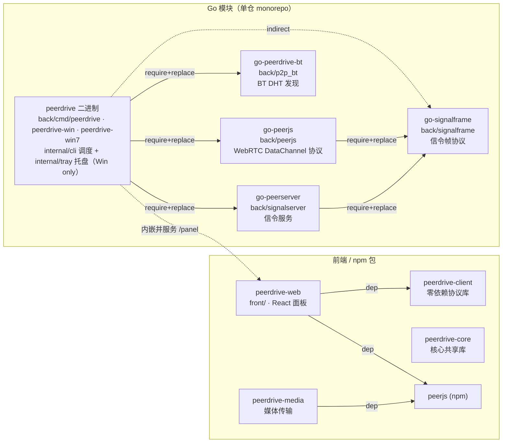
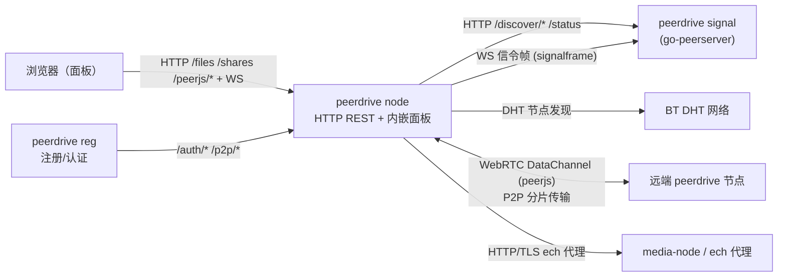

# Peerdrive Module Map

> 数据截至 `feat/win7-tray-patched-sdk`（2026-10-25，Win7 托盘入口改补丁 SDK 构建；基线 `refactor` @ `e738078`）。单仓库多模块：Go 模块在 `back/` 下平铺，
> 前端/npm 包在 `front/` + `packages/` 下。

## 构建期依赖图

## 运行期通信图

## 模块清单

| 模块 | 位置 | 职责 | 依赖 |
|---|---|---|---|
| peerdrive（server） | back/（cmd/peerdrive、cmd/peerdrive-win、cmd/peerdrive-win7、cmd/server；internal/cli、internal/tray） | 节点主服务：HTTP REST、存储、P2P 拉取、内嵌面板/peerjs 副本；平台入口分化见下节 | peerjs、p2p_bt、signalframe(i)、signalserver |
| go-peerjs | back/peerjs | WebRTC DataChannel 协议库（拨号/分片/增量 SHA-256） | signalframe、pion/webrtc/v4 |
| go-peerdrive-bt | back/p2p_bt | BT DHT 节点发现模块 | anacrolix/torrent |
| go-signalframe | back/signalframe | 信令帧协议（信号与 WS 帧定义），leaf | 无 |
| go-peerserver | back/signalserver | 信令 + 节点发现服务（/discover /status /peerjs、/_signal 面板） | signalframe、gorilla/websocket、sqlite |
| peerdrive-web | front/ | React 面板（构建产物内嵌进 server 二进制） | peerdrive-client、peerjs、react |
| peerdrive-client | packages/peerdrive-client | 零依赖 ESM 协议库 | 无 |
| peerdrive-core | packages/peerdrive-core | 核心共享库 | 无 |
| peerdrive-media | packages/peerdrive-media | 媒体传输/处理（node↔node wrtc 用例） | peerjs |
| media-node / echclient | back/cmd/ | iwara 内容代理 / IP 跳跃 ech 客户端 | back |

## 关键路径

1. **单二进制三服务**：`peerdrive`（默认/`serve`）= 节点；`peerdrive signal` = 信令+发现（go-peerserver）；
   `peerdrive reg` = 注册/认证/中继。旧三二进制（peerdrive-server / peersignal / peerdrive-reg-server）已合并。
2. **客户端 → 信令 → P2P**：浏览器面板 → 节点 HTTP（/files /shares /peerjs/*）+ WS；节点经 signalserver
   的 /discover 发现节点，信令握手走 WS signalframe 帧，最终节点间 **WebRTC DataChannel** 做分片文件传输
   （peerjs 协议）。
3. **发现双通道**：HTTP/WS 信令（signalserver）+ BT DHT（p2p_bt）两条节点发现路径。
4. **面板内嵌**：front 构建出 panel.html，server 二进制内嵌并在 /panel 服务（CI 校验内嵌副本与 dist/ 一致）；
   `pd-client` 内嵌副本已删除（防回归）。

## 平台入口分化（2026-10-24）

一个调度核心（`back/internal/cli`）+ 四个薄入口。入口之间**零逻辑复制**：差别只在
启动时传的平台选项，serve/signal/reg/all 等全部子命令走同一份代码。

| 入口 | 构建命令 | 目标平台 | 托盘 | import 面 |
|---|---|---|---|---|
| `back/cmd/peerdrive/` | `make build` | linux / darwin / windows 通用 | 无 | internal/cli（全子命令） |
| `back/cmd/peerdrive-win/` | `make build-win` | windows | 有 | 同左 + `Options.Tray=true` |
| `back/cmd/peerdrive-win7/` | `make build-win7`（→ `scripts/build-win7.sh`，补丁 SDK） | windows 386 + amd64（Win7~11） | 有 | 同 `peerdrive-win`（cli 全量子命令） |
| `back/cmd/server/` | `make build-server` | 通用（向后兼容） | 无 | 仅 gin + serverapp |

- **托盘只在 Windows 编译进二进制**：`back/internal/tray` 用 `//go:build windows`
  分流；非 Windows 平台 `Available()` 恒假，链接期不带任何 Win32 代码。
  实现是 LazyDLL 直调 user32/shell32（x/sys 早已不包装这些 API），无新增模块依赖。
- **运行期开关**：`PEERDRIVE_TRAY=0` 强制关闭托盘（服务化、CI、远程桌面场景）。
- **Win7 工具链：XTLS/go-win7 补丁 SDK**（2026-10-25 起，方案借鉴 Xray-core
  与上游 ech-proxy）。官方 Go 1.21.5+ 运行时启动阶段调用
  `bcryptprimitives.dll!ProcessPrng`，Win7 没有该 DLL，进程以
  `Exception 0xc0000005 (PC=0x0 in asmstdcall)` 崩在起跑线上——这就是
  「官方最后支持 Win7 的 Go 是 1.21」的由来。`scripts/build-win7.sh` 自动
  下载补丁 SDK（默认 `patched-1.26.7`）并锁 `GOTOOLCHAIN=local`，
  `back/go.mod`（go 1.26.2）与依赖树**完全不动**，产物兼容 Win7~11 的
  386/amd64。CI 由 go-build.yml 的独立 `build-win7` job 覆盖。备选（不推荐）：
  官方 Go 1.21.4 + 依赖树整体降级。
- **32 位编译**：`back/internal/downloader` 的 8GB 单次拉取上限已定型为 `int64`——
  未定型常量在 386 上是编译期错误（`overflows int`），修完后整模块
  windows/386 可编（CI 的 `build-win7` job 覆盖 386 产物）。